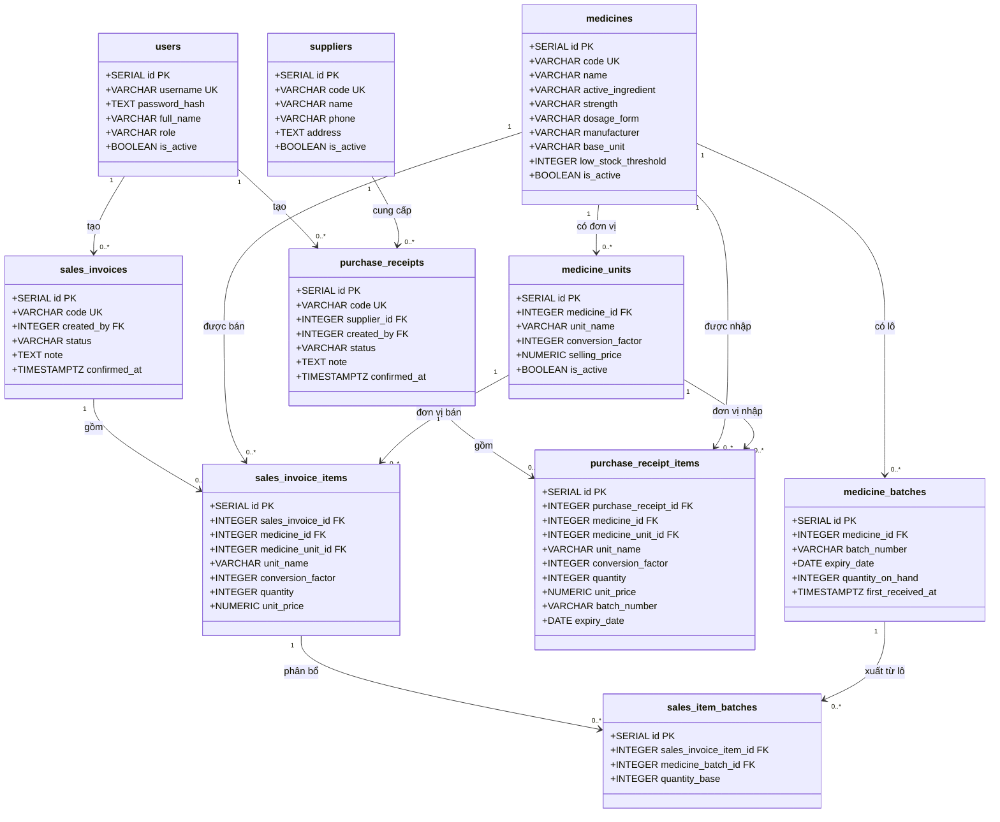

# Sơ đồ database

Sơ đồ quan hệ của 10 bảng trong `backend/sql/schema.sql`.
Các trường `created_at` và `updated_at` được lược bỏ để dễ đọc.

## Cách đọc và giới hạn

- PK: khóa chính; FK: khóa ngoại; UK: giá trị duy nhất.
- `1` và `0..*`: mỗi bản ghi con thuộc đúng một bản ghi cha; một bản ghi cha có thể chưa có hoặc có nhiều bản ghi con.
- Phiếu nháp có thể chưa có dòng chi tiết. Backend phải kiểm tra có dòng hợp lệ trước khi xác nhận.
- `medicine_batches` có ràng buộc duy nhất theo bộ `(medicine_id, batch_number, expiry_date)`.
- `sales_item_batches` có ràng buộc duy nhất theo cặp `(sales_invoice_item_id, medicine_batch_id)`.
- `purchase_receipt_items` chưa có khóa ngoại đến lô. Khi xác nhận nhập, backend tìm hoặc tạo lô theo thuốc, số lô và hạn sử dụng.
- Backend cần kiểm tra đơn vị thuộc đúng thuốc, lô xuất thuộc đúng thuốc và tổng lượng phân bổ khớp lượng bán; các khóa ngoại riêng lẻ chưa đảm bảo các quy tắc này.
- Cập nhật sơ đồ khi thay đổi cấu trúc database.
